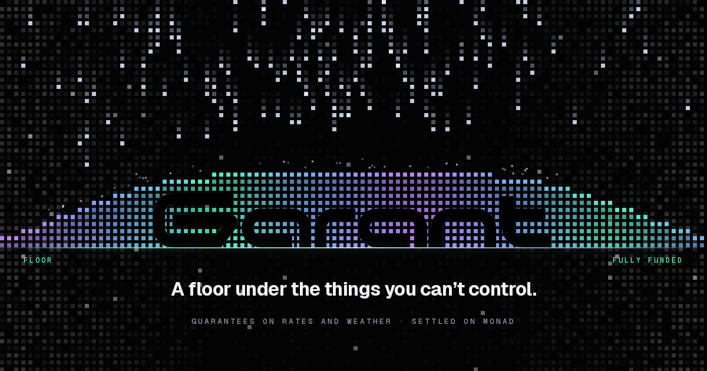
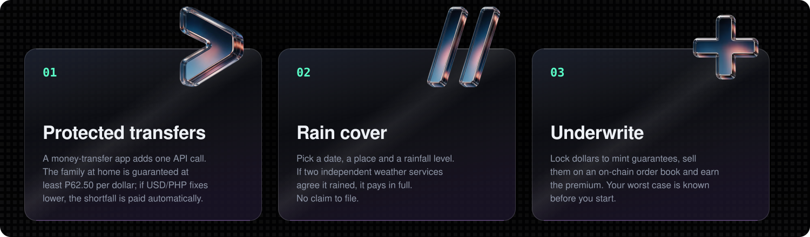
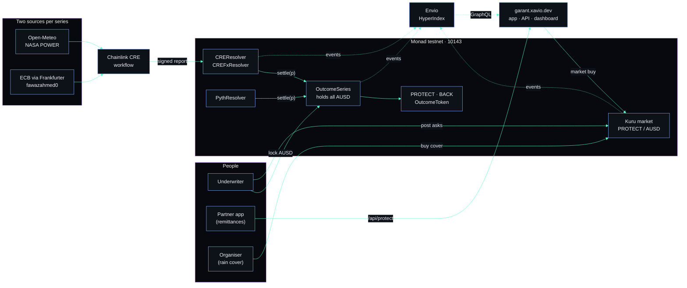
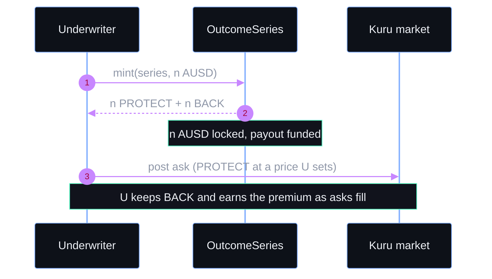
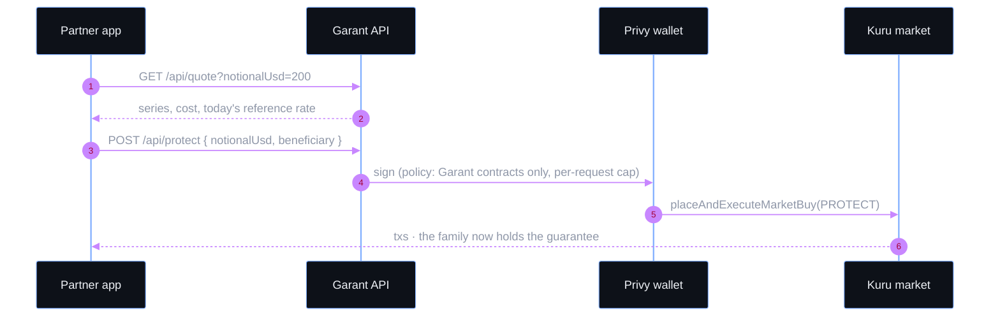
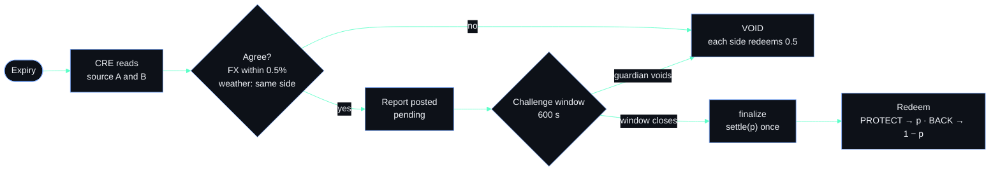
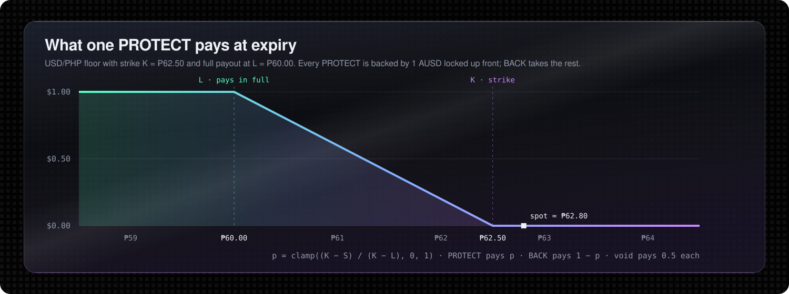
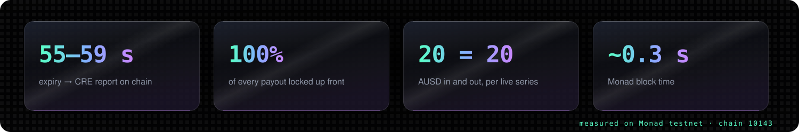
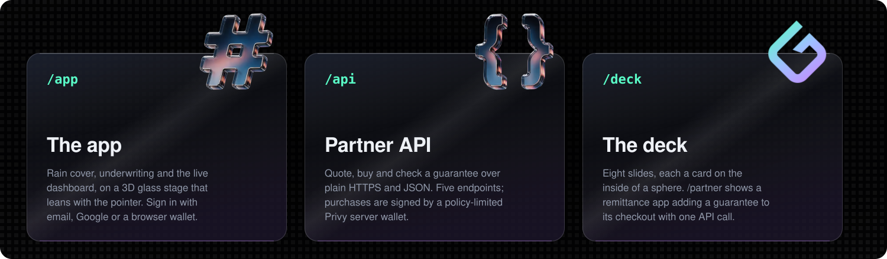

<div align="center">


# GARANT

### **A floor under the things you can't control**

<br>

[](#deployed-contracts)
[](./LICENSE)
[](#repository-layout)
[](#security)
[](#sponsor-integrations)
[](#sponsor-integrations)
[](#the-indexer)

<br>

**[Background](#the-background)** · **[What it does](#what-it-does)** · **[Install](#install)** · **[Architecture](#architecture)** · **[Flows](#flow--one-dollar-in-two-claims-out)** · **[Why Monad](#why-monad)** · **[Contracts](#deployed-contracts)** · **[Surfaces](#the-surfaces)** · **[Security](#security)**

<br>

<a href="https://garant.xavio.dev"></a>

<br><br>
</div>

**Garant** issues fully collateralised guarantees on real-world outcomes: a minimum exchange rate for a family
receiving remittances, or a payout if it rains on an event day. Each guarantee is priced on a **Kuru** order book
and settled automatically by a **Chainlink CRE** workflow that reads two independent data sources. **Envio**
indexes all of it for the live dashboard.

Every payout is funded before anyone can buy. Locking 1 AUSD mints one guarantee (PROTECT) and one backing share
(BACK), and a complete set can always be redeemed for exactly 1 AUSD, so the money for the worst case is already
in the contract.

Built for **Monad Metropolis, Track 1 (Onchain Finance & Trading)**. It runs on **Monad testnet (chain 10143)**
and stays there until audited.

| | |
|---|---|
| Live app | https://garant.xavio.dev |
| Dashboard | https://garant.xavio.dev/app/dashboard |
| Deck | https://garant.xavio.dev/deck |

---

## Sponsor integrations

| | Integration | Where |
|---|---|---|
| **Kuru** | One permissionless PROTECT/AUSD market per series, created through the Router. Underwriters deposit and post asks through the MarginAccount; partners buy with `placeAndExecuteMarketBuy`. | `contracts/script/Seed.s.sol`, `sdk/src/market.ts` |
| **Chainlink CRE** | The product depends on it to settle. The workflow reads due series on Monad, reaches consensus over two HTTP sources and writes reports to the resolvers. It runs with `cre workflow simulate --broadcast` against the CRE simulation forwarder, because the team account does not have deploy access yet; the owner can switch the resolvers' forwarder. | `cre/weather-resolve/` |
| **Envio** | HyperIndex on HyperSync indexes series, mints, redemptions, CRE reports and Kuru trades. Markets are registered dynamically from `MarketSet`. It powers the live dashboard. | `indexer/` |
| **Pyth** | `PythResolver` settles crypto floors from the first price print at or after expiry. | `contracts/src/resolvers/PythResolver.sol` |

---

## The background

Some people can't afford for the number to move. A family on a fixed peso budget lives on the dollar rate. An
organiser with one outdoor date lives on the forecast. Neither can hedge today: the tools are built for traders,
and claims on traditional cover take weeks.

Prediction markets already let people bet on the world. Garant uses the same mechanics to let them **protect
themselves from it**. The protection is fully funded up front, it is priced in the open on an on-chain order
book, and it settles itself from public data, with no claim form.

---

## What it does

> *"Guarantee the family at least ₱62.50 per dollar, fund the shortfall before anyone buys, and let two public
> sources decide the outcome."*



- **Protected transfers (FX floors).** A remittance app makes one API call and the recipient is guaranteed at
  least ₱62.50 per dollar. If the official ECB reference rate on the fixing date is lower, the shortfall is paid
  automatically in AUSD.
- **Rain cover (weather).** An organiser buys a guarantee that pays if rainfall at a location on a date reaches a
  threshold.
- **Underwriting.** Anyone can lock AUSD to mint guarantee sets and sell the protection leg on Kuru, earning a
  premium that does not move with crypto prices.

---

## Install

**Prerequisites:** Node 20+, pnpm, Foundry, Bun, CRE CLI ≥ 1.30, Docker (for the indexer). Copy `.env.example` to
`.env` and fill it in.

```bash
git clone https://github.com/xavio2495/Garant && cd Garant
pnpm install && pnpm --filter @garant/sdk build   # the web app bundles the SDK
pnpm --filter web dev                             # http://localhost:3000
```

| Variable | When | Purpose |
|---|---|---|
| `NEXT_PUBLIC_INDEXER_URL` | build | Envio GraphQL endpoint (the dashboard reads it) |
| `NEXT_PUBLIC_SITE_URL` | build, optional | Public URL for absolute social-card links |
| `NEXT_PUBLIC_PRIVY_APP_ID` | build, optional | Empty means browser-wallet sign-in |
| `TESTER_PRIVATE_KEY` | server | Partner treasury signer for `/api/protect` (returns 503 without it) |
| `PARTNER_MAX_AUSD_PER_REQUEST` | server | Per-request spend cap (default 5) |

---

## Architecture



### Who holds what

| Holder | Holds | Pays | Receives at settlement |
|---|---|---|---|
| Family, organiser or partner treasury | PROTECT | the premium, on Kuru | `p` AUSD per PROTECT |
| Underwriter | BACK (and the premium) | 1 AUSD per set, locked up front | `1 − p` AUSD per BACK |
| `OutcomeSeries` | every AUSD locked | | always equal to outstanding sets plus unredeemed claims |

---

## Flow ① — One dollar in, two claims out



## Flow ② — A partner buys a guarantee with one call



## Flow ③ — It settles itself, from two sources





For an FX floor with strike K and full-payout level L, `p = clamp((K − S) / (K − L), 0, 1)`, where S is the
fixing. The CRE FX report settles at the mid of the two sources; weather sources must agree on which side of the
threshold the day fell.

---

## Why Monad



| Measured on testnet | Value |
|---|---|
| Mint a guarantee set | 240,440 gas (0.0245 MON at 102 gwei) |
| Buy protection (Kuru market buy) | 301,616 gas (0.0308 MON) |
| CRE settlement report | 200k billed, ~141k used (0.0204 MON) |
| Finalise a settlement | 89,731 gas (0.0092 MON) |
| Redeem | 146,479 gas (0.0149 MON) |
| Create a Kuru market | 1,599,386 gas |
| Expiry → CRE report on chain | 55–60 s (live loop) |
| Report → final settlement | 600 s challenge window (by design), about 2,200 blocks at ~0.30 s/block |
| Pyth crypto floor, expiry → settled | 106 s |
| Price discovery | Fully on-chain order book (Kuru); no off-chain matching |

At these costs a guarantee on a $200 transfer is economical, and settlement lands seconds after the data is
published.

---

## Deployed contracts

### Monad testnet · 10143 · Sourcify-verified

| Contract | Address |
|---|---|
| OutcomeSeries | [`0xF86CdAeE90DB9901a5F104172294161085070C5A`](https://testnet.monadscan.com/address/0xF86CdAeE90DB9901a5F104172294161085070C5A) |
| CREFxResolver | [`0x987bf40239A6641C7B9c4E791d48e5CC5ddEa86c`](https://testnet.monadscan.com/address/0x987bf40239A6641C7B9c4E791d48e5CC5ddEa86c) |
| CREResolver | [`0xA5dCB9B329b17253FF35202dEb7a2093d06fd7b0`](https://testnet.monadscan.com/address/0xA5dCB9B329b17253FF35202dEb7a2093d06fd7b0) |
| PythResolver (crypto floors) | [`0x57706A10f41d4649fE65de6D38c3eCe429D2d147`](https://testnet.monadscan.com/address/0x57706A10f41d4649fE65de6D38c3eCe429D2d147) |

Series and their Kuru markets are listed in `deployments/10143.json`; the SDK's `listSeries` returns them live.

<details>
<summary><b>Example transactions</b></summary>

| Step | Transaction |
|---|---|
| Kuru market created | [`0xc664650e…d3d9`](https://testnet.monadscan.com/tx/0xc664650ed8ecfeb57c0331ceb2f26c67b913134f0ae542f2c08159c78421d3d9) |
| Mint | [`0x6b1bc1d0…7966`](https://testnet.monadscan.com/tx/0x6b1bc1d077f22bf873b60314a696077814de8a3d8128303c136797158f597966) |
| CRE weather report (YES) | [`0xaebad542…9b08`](https://testnet.monadscan.com/tx/0xaebad54215a06a719549b5993ee94cdec4444fb23e641629c7b38bace70c9b08) |
| CRE weather report (VOID, sources disagreed) | [`0xf9a4d2b1…9be2`](https://testnet.monadscan.com/tx/0xf9a4d2b160080f69437707fbaf270e7c731a3bb4b26fd245b92da7d6e3ce9be2) |
| CRE FX report (USD/PHP 63.00 floor, 2026-10-09 fixing; finalised payout 6.49%) | [`0x1a57585a…7855`](https://testnet.monadscan.com/tx/0x1a57585a7d3939a38e5fe9536fa6d40f2a5d6a57c33b5e58568b22116c757855) |
| Finalise after the challenge window | [`0xc4239d5e…0134`](https://testnet.monadscan.com/tx/0xc4239d5efa92ed2dfe3796c8bb95a0193dffb9f348504ced9c214537a5710134) |
| CRE FX report (USD/PHP 62.50 floor, pays 0) | [`0x738e4a21…f8c5`](https://testnet.monadscan.com/tx/0x738e4a21f97930c76c88482a8eaa7913a06a00900a23ca1fd4d49003690af8c5) |

</details>

### End to end on testnet: create → mint → settle → redeem

Two live series ran through the full loop. Payouts matched the expected values exactly, and 20 AUSD in equalled
20 AUSD out per series.

| Series | Settled | Beneficiary received | Underwriter received |
|---|---|---|---|
| Manila rain ≥ 10 mm on 2026-09-10 | YES, 100% (report [`0x21df…c636`](https://testnet.monadscan.com/tx/0x21df52345b35ebbf9c3a7bc82588d5d12457c685f44bd7ca65b15a94d0acc636), final [`0xe00d…8138`](https://testnet.monadscan.com/tx/0xe00d036993bf981fbdfbef9282e6309552a0745bb2cdb5725b574d9fb1fa8138)) | 10 PROTECT → **10 AUSD** ([`0xad97…1efc`](https://testnet.monadscan.com/tx/0xad977ecdee7436233e75aa406435049475ba3dae7a437d137b85d28f9a931efc)) | 10 sets + 10 BACK → **10 AUSD** ([`0xb673…a7f6`](https://testnet.monadscan.com/tx/0xb67322c4eedf4fed68dc9afb431abad231ece0e49098d7c40afa86806ba6a7f6)) |
| USD/PHP ₱63.00 floor, 2026-10-09 fixing (mid 62.8055) | 6.488% (report [`0x8582…9062`](https://testnet.monadscan.com/tx/0x8582e437684cdd721d5f087e3ae5d3694c35cf04d662f9094d5e750e3c649062), final [`0x0d1f…b942`](https://testnet.monadscan.com/tx/0x0d1f8f5c83fb816ff3f7178557ca0ee09eb8d0d5f99cd24a31fca0bd0cd6b942)) | 10 PROTECT → **0.6488 AUSD** ([`0x5d33…0e44`](https://testnet.monadscan.com/tx/0x5d33940ac60fca88ed42b10a09910bb108bea5fcc9230c10283d1247e0b30e44)) | 10 sets + 10 BACK → **19.3512 AUSD** ([`0x669b…4132`](https://testnet.monadscan.com/tx/0x669b13aff24581f1e34afc4eacf36b2612b4668d52a24a710ef476d330484132)) |

---

## The indexer

Envio HyperIndex on Monad testnet (`indexer/`), reading through HyperSync with the public RPC as a fallback
(`ENVIO_RPC_FOR=sync` indexes over RPC only).

| Entity | From | Feeds |
|---|---|---|
| `Series` | `SeriesCreated`, `Resolved`, `Voided` | the series table, settlement speed |
| `Mint`, `SetRedeem`, `Redemption` | `Minted`, `SetRedeemed`, `Redeemed` | money locked, payouts |
| `WeatherReport`, `FxReport` | `ReportReceived`, `FxReportReceived` | past rain readings, review windows |
| `Market`, `Trade` | `MarketSet`, then Kuru `Trade` from each market registered dynamically | protection bought, fees |
| `Account`, `Stats` (`"global"`) | all of the above | people and partners, the dashboard's headline figures |

---

## The surfaces



`/partner` is a demo remittance app (Hatid) that adds a Garant guarantee to its checkout through the API, and any
unknown address lands on a 404 where the rain fills the digits.

---

## Pricing a guarantee

Garant's demo underwriter quotes the 30-day USD/PHP floor (strike ₱62.50, full payout at ₱60.00) at 0.11 AUSD per
PROTECT. That is the expected payout, about 0.10, plus a 10% margin.

- Spot is near ₱62.80, and USD/PHP volatility is around 5.5% a year.
- That gives roughly a 38% chance the peso fixes below the strike within 30 days.
- Large moves are rare, so the expected payout is only about 10% of the maximum.

Every PROTECT is backed 1:1 by locked AUSD, so the underwriter's worst case is known up front: 0.89 AUSD per
contract sold.

The demo underwriter (`0x4887…DD55`) and the demo partner treasury (`0x8B49…e9b1`) are team wallets. The dashboard
labels them and keeps them out of traction figures.

---

## Security

Garant is unaudited and runs on testnet only.

**Trust assumptions**
- The two data sources per series.
- The CRE forwarder.
- A guardian that can void a pending report during the challenge window.
- The owner, who creates series and can switch the forwarder.

> **On testnet the CRE simulation forwarder may not verify DON signatures.** That is why reports are re-checked on
> chain and pass through a challenge window.

**Testing**
- 66 Foundry tests: unit, fuzz, invariant, and fork tests against the real Pyth and Kuru contracts on Monad testnet.
- `src/` coverage: 100% of lines and 90.8% of branches.
- Slither: no high-severity findings, and no actionable medium or low ones.

**Tested invariants**
- Collateral always covers every claim.
- Settlement happens once, and only from the series' resolver.
- No redemption before resolution.
- A complete set always redeems at exactly 1.

Next steps: a multisig guardian, the production forwarder, and an audit.

---

## Repository layout

```
contracts/    Foundry: OutcomeSeries, OutcomeToken, CREFxResolver, CREResolver, PythResolver;
              unit, fuzz, invariant and fork tests
cre/          CRE TypeScript workflow: weather and FX settlement
indexer/      Envio HyperIndex
sdk/          @garant/sdk (viem): listSeries, quote, protect, mintSets, postAsk, withdrawProceeds, status, claim
web/          Next.js: landing, /app (cover, underwrite, dashboard), /deck, /api, /partner (demo remittance app)
deployments/  10143.json, the live series and markets
```

---

## Continuing development

```bash
# 1. Contracts (Foundry ≥ 1.x with soldeer). Add --no-match-path "test/fork/*" to skip fork tests offline.
cd contracts && forge soldeer install && forge test

# 2. The SDK. The web app bundles it, so build it first.
pnpm install && pnpm --filter @garant/sdk build

# 3. The indexer. HyperSync needs ENVIO_API_TOKEN; ENVIO_RPC_FOR=sync indexes over RPC instead.
cd indexer && pnpm envio dev

# 4. The web app. Point NEXT_PUBLIC_INDEXER_URL at the indexer's GraphQL endpoint for the dashboard.
pnpm --filter web dev

# 5. A CRE settlement run: writes reports for every due series.
cd cre && cre workflow simulate weather-resolve --target staging-settings -e ../.env --non-interactive --trigger-index 0 --broadcast
```

**Hosting the web app.** Build from the full workspace, since the app bundles `sdk/` and `deployments/10143.json`.
Requires Node ≥ 20.9.

```bash
pnpm install && pnpm --filter web build && pnpm --filter web start
```

---

## Pre-existing code and AI usage

**Pre-existing code:** none. Everything was written during the Metropolis build window. Libraries: OpenZeppelin, the
Pyth SDK, viem, the Chainlink CRE SDK, Envio, Next.js, GSAP and Lenis.

**AI usage:** AI coding assistants (Claude Code) were used throughout for research, design, implementation, tests
and documentation, with human review and direction. Contract logic, tests and deployment steps were verified by
running them.

---

## License

[MIT](./LICENSE)

---

<br><br>

<div align="center">

<h3>Built by

[Immanuel](https://github.com/xavio2495) x [Charles](https://github.com/charlesms1246)

</h3>

<sub><a href="https://garant.xavio.dev">garant.xavio.dev</a> · <a href="https://garant.xavio.dev/app">app</a> · <a href="https://garant.xavio.dev/deck">deck</a> · <a href="https://garant.xavio.dev/api">partner API</a> · Monad Metropolis 2026</sub>

</div>
